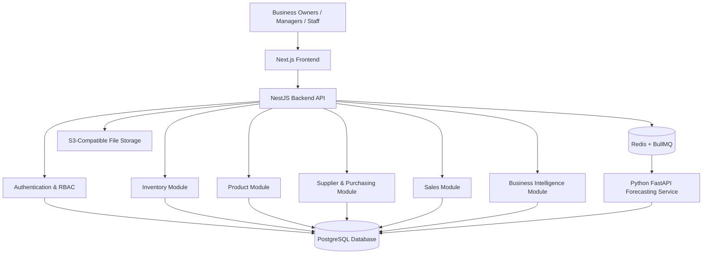

# 🚀 TrueStock AI

### Smart Inventory Management & Business Intelligence Platform

**Manage smarter. Predict demand. Grow your business.**

TrueStock AI is a modern, AI-powered inventory management and business intelligence SaaS platform designed to help retailers, wholesalers, and distributors transform the way they manage their inventory and make business decisions.

The platform combines intelligent stock management, sales analytics, supplier management, demand forecasting, and automated alerts to help businesses reduce stock-related problems, improve operational efficiency, and make data-driven decisions.

---

## 🌟 Project Vision

Traditional inventory management systems often focus only on recording stock quantities. TrueStock AI aims to go further by combining inventory operations with business intelligence and predictive analytics.

Our goal is to build a centralized platform where businesses can:

- 📦 Manage products, inventory, and multiple storage locations.
- 📊 Monitor sales and business performance.
- 🤖 Predict future product demand using machine learning.
- 🔔 Receive intelligent low-stock and inventory alerts.
- 🛒 Manage suppliers and purchase orders.
- 📈 Make smarter purchasing and inventory decisions.
- 🏢 Manage multiple businesses through a multi-tenant SaaS architecture.

---

## ✨ Key Features

### 📦 Inventory Management
- Product and category management.
- SKU and barcode support.
- Real-time stock tracking.
- Multiple shop and warehouse support.
- Stock transfers and adjustments.
- Inventory movement history.
- Low-stock monitoring.

### 🛒 Supplier & Purchasing Management
- Supplier information management.
- Purchase order creation and tracking.
- Goods receiving management.
- Supplier lead-time tracking.
- Purchase history.

### 💰 Sales Management
- Sales transaction recording.
- Sales history and reporting.
- Product-level sales analysis.
- Sales performance monitoring.

### 📊 Business Intelligence Dashboard
- Real-time inventory overview.
- Sales performance analytics.
- Stock valuation insights.
- Best-selling and slow-moving products.
- Business performance reports.

### 🤖 AI-Powered Demand Forecasting
- Historical sales analysis.
- Demand forecasting.
- Predicted stock requirements.
- Intelligent reorder recommendations.
- Forecast performance evaluation.

### 🔔 Smart Alerts & Notifications
- Low-stock alerts.
- Reorder notifications.
- Inventory-related warnings.
- Business activity notifications.

### 🏢 Multi-Tenant SaaS Architecture
- Multiple business accounts.
- Tenant-based data isolation.
- Role-based access control.
- Secure user authentication.
- Subscription-ready architecture.

---

## 🧰 Technology Stack

| Layer | Technologies |
|---|---|
| Frontend | Next.js, React, TypeScript |
| UI Styling | Tailwind CSS |
| Backend | Node.js, NestJS |
| Database | PostgreSQL |
| ORM | Prisma |
| AI / ML Service | Python, FastAPI |
| Data Processing | Pandas, NumPy |
| Machine Learning | Scikit-learn, Statsmodels, LightGBM |
| Background Jobs | Redis, BullMQ |
| File Storage | S3-compatible Object Storage |
| Version Control | Git & GitHub |
| CI/CD | GitHub Actions |
| Deployment | AWS / GCP / Managed Cloud Platforms |

---

## 🏗️ System Architecture

TrueStock AI follows a **Modular Monolith Architecture** for its core business application, with a separate Python-based forecasting service.



---

## 🧠 AI & Machine Learning Approach

TrueStock AI is designed to introduce intelligence progressively as reliable business data becomes available.

| Stage | Approach | Purpose |
|---|---|---|
| Stage 0 | Rule-based analytics | Moving averages, sales velocity, ABC analysis, and days of cover |
| Stage 1 | Statistical forecasting | Demand forecasting using historical sales data |
| Stage 2 | Machine learning | Advanced forecasting using LightGBM |
| Stage 3 | Inventory optimization | Improved replenishment and purchasing decisions |

The platform will use historical sales data to generate demand forecasts and support intelligent reorder recommendations.

**Important:** Forecasting recommendations are designed to support business owners. Purchasing decisions remain under human approval.

---

## 🔐 Security & Data Management

Security and data isolation are important parts of the platform.

Planned security considerations include:

- Tenant-level data isolation.
- Secure authentication and authorization.
- Role-based access control (RBAC).
- Audit logs for important business activities.
- Secure API design.
- Database transaction management.
- Data backup and recovery procedures.

---

## 📂 Project Structure

The planned repository structure is:

```text
TrueStock-AI/
│
├── frontend/
│   ├── src/
│   ├── public/
│   └── package.json
│
├── backend/
│   ├── src/
│   │   ├── auth/
│   │   ├── users/
│   │   ├── tenants/
│   │   ├── products/
│   │   ├── inventory/
│   │   ├── suppliers/
│   │   ├── purchases/
│   │   ├── sales/
│   │   └── analytics/
│   └── package.json
│
├── forecasting-service/
│   ├── app/
│   ├── models/
│   └── requirements.txt
│
├── infrastructure/
│
├── docs/
│   └── architecture/
│
├── .gitignore
└── README.md
```

*This is the intended structure; folders and modules will be added as development progresses.*

---

## 🚀 Development Roadmap

TrueStock AI is planned as a six-month development project.

| Phase | Main Activities |
|---|---|
| Month 01 | Requirements, architecture, database design, and project setup |
| Month 02 | Authentication, multi-tenancy, products, and inventory management |
| Month 03 | Suppliers, purchasing, sales, and stock operations |
| Month 04 | Frontend integration, dashboards, analytics, and alerts |
| Month 05 | AI forecasting, machine learning, and reorder recommendations |
| Month 06 | Testing, security improvements, deployment, and pilot launch |

---

## ⚙️ Getting Started

The application is under active development. Setup instructions will be expanded as the frontend, backend, database, and forecasting service become available.

### Prerequisites

- Node.js
- npm
- Python
- PostgreSQL
- Git

### Clone the Repository

```bash
git clone https://github.com/YOUR_USERNAME/TrueStock-AI.git
```

```bash
cd TrueStock-AI
```

### Development Setup

Installation and environment configuration instructions will be added for each service as its implementation is completed.

Do not commit `.env` files, database passwords, API keys, or other secrets to the repository.

---

## 🎯 Project Goals

The main objectives of TrueStock AI are to:

1. Simplify inventory management for growing businesses.
2. Improve stock visibility and operational accuracy.
3. Reduce unnecessary overstocking and stock shortages.
4. Provide meaningful business intelligence.
5. Introduce reliable AI-powered demand forecasting.
6. Build a scalable, secure, multi-tenant SaaS platform.

---

## 🔮 Future Enhancements

Potential future versions may include:

- 📱 Flutter-based mobile application.
- 📷 Barcode scanning.
- 💬 WhatsApp inventory notifications.
- 🏭 Advanced warehouse management.
- 🔗 E-commerce platform integrations.
- 🤖 Conversational AI business assistant.
- 💹 Advanced pricing and profit-margin optimization.

---

## 🤝 Contributions

Contributions, suggestions, and feedback are welcome as the project develops.

If you would like to contribute:

1. Fork this repository.
2. Create a feature branch.
3. Commit your changes.
4. Push your branch.
5. Open a Pull Request describing your changes.

---

## 📌 Project Status

🚧 **Currently in Development**

TrueStock AI is being developed as a six-month project, progressing from system architecture and core inventory operations toward business intelligence, AI forecasting, testing, and deployment.

---

## 👨‍💻 Author

**TrueStock AI — Smart Inventory Management & Business Intelligence**

*Building smarter inventory systems for modern businesses.*

---

⭐ If you find this project interesting, consider giving the repository a star!

**Manage smarter. Predict better. Grow faster.**
